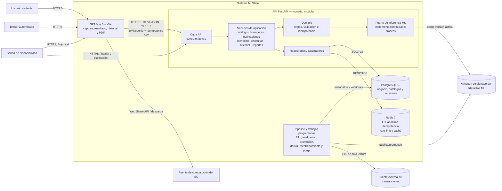

# Arquitectura consolidada de MLState

## Decisión definitiva

Se adopta una arquitectura **cliente-servidor con SPA y backend monolítico modular en capas**. El motor de inferencia comienza dentro del proceso del backend, detrás de un puerto/adaptador, y puede extraerse como servicio si las mediciones de rendimiento o aislamiento lo justifican. PostgreSQL conserva el estado de negocio y Redis el estado efímero. Los trabajos de datos, entrenamiento, promoción y purga quedan fuera de la ruta síncrona.

Esta decisión conserva el consenso de los dos diseños y agrega los componentes operativos explícitos de Chris sin introducir microservicios prematuros.

## Diagrama definitivo

## Responsabilidades e interfaces

| Elemento | Responsabilidad | Interfaz principal |
|---|---|---|
| SPA | Captura guiada, estado temporal, accesibilidad, presentación y compartición | HTTPS/JSON; Web Share API |
| API | Ejecutar los casos de uso definidos por `openapi_equipo.yaml` | REST `/api/v1` sobre TLS 1.3 |
| Módulos internos | `catalogo`, `borradores`, `estimaciones`, `identidad`, `consultas`, `historial`, `reportes`, `gobierno_modelo` | Servicios y puertos internos; sin acceso a tablas de otro módulo |
| Motor ML | Rango, margen, confianza, comparables y explicación | Puerto síncrono con timeout de 5 s |
| PostgreSQL | Usuarios, catálogo, borradores, estimaciones, historial y metadatos versionados | SQL transaccional/TLS |
| Redis | Sesión anónima de 60 min, idempotencia, cuota y caché | RESP/TCP con TTL |
| Pipeline | Ingesta, calidad, reentrenamiento, evaluación, promoción, deriva y purga | ETL batch, SQL y almacenamiento S3-compatible |
| Sonda | Verificar disponibilidad mediante el flujo real | HTTPS |

## Reglas arquitectónicas

1. La API permanece sin estado local para admitir réplicas horizontales.
2. Los módulos dependen de interfaces, no de tablas o implementaciones de otros módulos.
3. La inferencia es síncrona para el flujo del usuario; entrenamiento, promoción y purga son trabajos separados.
4. PostgreSQL es la fuente durable; Redis nunca es la única copia de información histórica.
5. No se almacenan dirección exacta, coordenadas ni datos del propietario.
6. La extracción del motor a un servicio se decide por métricas de p95, concurrencia o aislamiento, no de forma anticipada.

## Conflictos resueltos

- **Motor separado vs. in-process:** se representa como componente con frontera propia, pero inicialmente in-process; conserva rendimiento y una ruta de extracción.
- **Base única vs. PostgreSQL + Redis:** PostgreSQL conserva el estado durable y Redis sólo el efímero, necesario para TTL, idempotencia y rate limiting.
- **“Trabajos programados” genéricos vs. pipeline explícito:** se adopta el pipeline explícito, incluyendo extracción autorizada y almacén de artefactos.
- **Actores y sistemas externos implícitos vs. explícitos:** se incluyen visitante, broker, sonda, fuente de datos, almacén de artefactos y puente del SO porque delimitan el sistema y sus protocolos.
